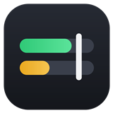
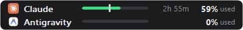
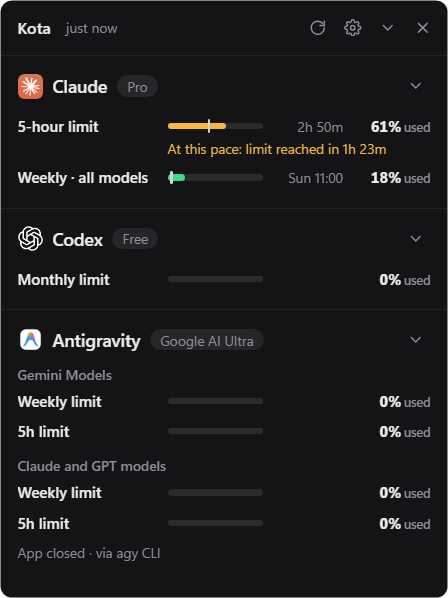

<p align="center"></p>

<h1 align="center">Kota</h1>

<p align="center"><b>Your AI usage limits, right on the Windows taskbar.</b><br>
Claude · Codex · Antigravity — one glance, no browser tabs.</p>

<p align="center"></p>

*Kota* is Turkish for *quota*. It sits next to the Start button and shows how much of your 5-hour
(or weekly) limits you have used, with a marker for how much of the window has passed — so you can
tell at a glance whether you're burning through it faster than the clock.

<p align="center"></p>

## Features

- **Taskbar pill** — up to two providers, their 5-hour limit (or the most-used one), reset countdown.
- **Pace marker** — the thin line on each bar is how much of the window has elapsed. Past the line
  means you're ahead of the clock; the panel warns *"At this pace: limit reached in 1h 22m"*.
- **Panel** (click the pill) — every limit of every provider, token totals for the last 5 h / 7 days,
  and a **7-day usage chart**.
- **Notifications** — at a warning and a critical threshold (80 % / 95 % by default, adjustable),
  and when a used-up limit is available again. Held back during fullscreen, games and presentations.
- **Follow the tool you're using** (optional) — the pill shows Claude first while you're in Claude
  Code, Codex while you're in Codex, … including CLIs running inside terminals and editors.
- **All monitors** (optional) — a pill on every taskbar.
- Light / dark theme, drag to reposition, right-click menu, hover tooltip, start with Windows.
- Adaptive refresh: every 2 min while you're active, 15 min when idle, right after a limit resets.
- Small: one ~15 MB exe, no runtime to install (WebView2 ships with Windows 11).

## Install

1. Download **Kota.exe** from the [latest release](../../releases/latest).
2. Run it. It offers to install for your user (no admin rights): `%LOCALAPPDATA%\Programs\Kota`,
   a Start menu entry, and an entry in *Settings → Apps* to uninstall. Choose *No* to run it portable.
3. To update, run a newer Kota.exe and choose *Yes* — your settings are kept.

Windows SmartScreen may warn because the exe isn't code-signed: *More info → Run anyway*.

### What it needs

Sign in to the tools you use; Kota reads their existing local sign-in, nothing else:

| Provider | Where the data comes from |
|---|---|
| **Claude** | Claude Code's sign-in (`~/.claude/.credentials.json`, run `claude` → `/login`). Plan limits from Anthropic's usage endpoint; token totals from local Claude Code logs. |
| **Codex** | The Codex app / CLI sign-in (`~/.codex/auth.json`, read-only). Limits from ChatGPT's usage endpoint; tokens from local session logs. |
| **Antigravity** | The running Antigravity app (local language server), or the `agy` CLI when the app is closed. |

Providers that aren't installed are simply hidden.

## Privacy

- Your tokens are only ever sent to the service they belong to (Anthropic, OpenAI, Google).
  No analytics, no telemetry, no servers of ours.
- Kota never writes to Codex's credentials. For Claude, an expired access token is refreshed the
  same way Claude Code does it and written back with every other field preserved.
- Settings, caches and the 7-day history live in `%APPDATA%\Kota`.

> The usage endpoints Kota uses are not officially documented and may change with tool updates.
> Kota is an independent project, not affiliated with or endorsed by Anthropic, OpenAI or Google;
> product names and logos are trademarks of their respective owners.

## How it works

Windows 11 has no API for third-party taskbar widgets (the weather widget is part of Explorer), so:

| Part | File | Approach |
|---|---|---|
| Pill | `pill_windows.go` | A GDI-drawn native window, child of `Shell_TrayWnd`. It must be `WS_EX_LAYERED` (the Win11 taskbar is DirectComposition; a plain GDI child is invisible). |
| Position | `uia_windows.go` | Finds the Start button with UI Automation (on its own thread — calling it from the pill's thread deadlocks with Explorer) and follows taskbar changes via `SetWinEventHook`. |
| Explorer restarts | `pill_windows.go` | Re-created on the `TaskbarCreated` broadcast. |
| Panel | `panel_windows.go` | The Wails (WebView2) window, a plain top-most popup shown above the pill. |
| Data | `app.go`, `refresh.go`, `providers/` | Fetches all providers in parallel on an adaptive schedule. |
| Multiple monitors | `pills_windows.go` | One pill per `Shell_SecondaryTrayWnd`. |
| Installer | `install_windows.go` | The exe copies itself, creates the shortcut with `IShellLink` and an uninstall entry. |
| History | `history.go` | Samples each limit at most every 10 min (sooner if it moves), kept 7 days. |

## Build

Requires Go 1.26+ and the [Wails v2 CLI](https://wails.io/docs/gettingstarted/installation).

```bash
wails build -clean -skipbindings -trimpath   # build/bin/Kota.exe
go test ./...
go run ./cmd/probe                           # provider output as JSON, no UI
```

Run a dev build with `--portable` to skip the install prompt. The icon is generated from
`build/logo.svg`'s geometry by `build/makeicon.ps1`.

Adding a provider: implement the `Provider` interface in `providers/` and register it in `providers.All()`.

## License

[MIT](LICENSE)
